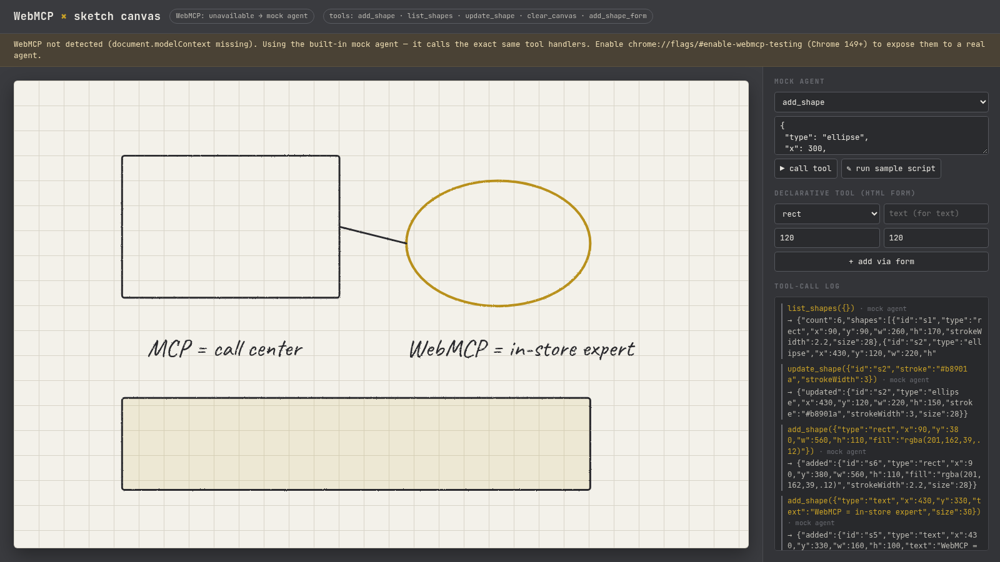

# WebMCP × sketch canvas

A tiny, single-file-ish (no build step) vector sketch canvas that exposes its actions to in-browser AI agents through **WebMCP**.



## Tools exposed

| Tool | Kind | What it does |
|---|---|---|
| `add_shape` | imperative (`document.modelContext.registerTool`) | add rect / ellipse / line / text |
| `list_shapes` | imperative (read-only) | list shapes with ids |
| `update_shape` | imperative | patch a shape by id |
| `clear_canvas` | imperative | remove everything |
| `add_shape_form` | declarative (`<form toolname tooldescription>`) | add a shape via an annotated HTML form |

If `document.modelContext` is missing, a banner appears and a built-in **mock agent** panel calls the *same* handlers, so the demo works in any browser.

## Run

```bash
python3 -m http.server 8000   # ES modules need http://, not file://
open http://localhost:8000/?autoplay   # ?autoplay runs a sample tool-call script
```

### Try real WebMCP in Chrome
- Chrome **149+**: enable `chrome://flags/#enable-webmcp-testing` (local dev), restart.
- Optional: install the **Model Context Tool Inspector** extension to list/call the tools (it may also want `chrome://flags/#prompt-api-tool-use`).
- For a deployed origin, register for the **WebMCP origin trial** and paste the token into the commented `<meta http-equiv="origin-trial">` in `index.html`.
- The declarative form API is documented by Chrome but is still listed as "future exploration" in the W3C CG explainer — treat it as experimental.

## Use it from Claude Code / Codex

Claude Code and Codex are MCP clients that live in your terminal, while WebMCP tools live inside a browser tab. To connect them, give the agent a browser through [Playwright MCP](https://github.com/microsoft/playwright-mcp). Launch that browser as your local Chrome with the WebMCP flag on, and the agent can open the page, discover the tools, and call them.

**1. Start the demo**

```bash
git clone https://github.com/Kayshen-X/webmcp-sketch.git && cd webmcp-sketch
python3 -m http.server 8000
```

**2. Add Playwright MCP with WebMCP enabled** (uses `playwright-mcp.config.json` from this repo, Chrome 149+)

```bash
# Claude Code
claude mcp add webmcp-browser -- npx @playwright/mcp@latest --config "$PWD/playwright-mcp.config.json"

# Codex
codex mcp add webmcp-browser -- npx @playwright/mcp@latest --config "$PWD/playwright-mcp.config.json"
```

**3. Ask the agent**, for example:

> Open http://localhost:8000. Use browser_evaluate to list the tools in `document.modelContext.getTools()`, then call `add_shape` three times with `document.modelContext.executeTool(tool, args)` to draw a rectangle, an ellipse and the text "hello WebMCP". Finish with `list_shapes`.

The page's tool-call log should show `agent via WebMCP`, and the status pill should read `WebMCP: available`. If it says `unavailable`, the flag didn't take effect, so check your Chrome version.

Notes:
- `executeTool` takes the tool object returned by `getTools()` (not its name) and an args object. This matches what Chrome 156 does with `WebMCPTesting` and may change while the API is experimental.
- In this setup the agent calls WebMCP tools through Playwright's `browser_evaluate`. Claude Code and Codex don't speak WebMCP natively yet.
- `?autoplay` replays a sample script through the same `getTools` and `executeTool` path, and `?mock` forces the mock agent.

## MCP vs WebMCP

| | MCP | WebMCP |
|---|---|---|
| Analogy | Call center (backend, always on) | In-store expert (on the page) |
| Runs | Server / process | Browser tab, page JS |
| Lifetime | Persistent | Ephemeral — only while the page is open |
| Primitives | tools, resources, prompts | tools only |
| Auth | Its own | Reuses the user's session |
| Best for | Core business logic | Contextual page actions |

Use both: MCP for core logic, WebMCP for what the user is looking at right now.

## Sources
- Explainer: https://github.com/webmachinelearning/webmcp
- Declarative explainer: https://github.com/webmachinelearning/webmcp/blob/main/declarative-api-explainer.md
- Chrome docs: https://developer.chrome.com/docs/ai/webmcp · https://developer.chrome.com/docs/ai/webmcp/declarative-api
- Inspired by Google Developers China (谷歌开发者) WeChat article, 2026-11-03: 「WebMCP 开发指南｜一文搞懂 WebMCP 与 MCP 的差异与协同」 https://mp.weixin.qq.com/s/4Ud_v6lkIBPom19uv5Qw_Q

## 中文简介
一个无需构建的小型矢量画板 demo：通过 WebMCP（`document.modelContext.registerTool` + 声明式 `<form toolname>`）把 `add_shape / list_shapes / update_shape / clear_canvas` 暴露给浏览器内的 AI agent。浏览器不支持时自动切换到内置「模拟 agent」，调用同一套处理函数。
体验：Chrome 149+ 打开 `chrome://flags/#enable-webmcp-testing`，或使用 WebMCP Origin Trial。
在 Claude Code 或 Codex 里用：先通过 Playwright MCP 给 agent 接一个打开了 `WebMCPTesting` 的本地 Chrome，命令和示例提示词见上方的 “Use it from Claude Code / Codex”。agent 用 `getTools()` 找到工具，再用 `executeTool()` 调用。
一句话：MCP 是呼叫中心，WebMCP 是店内专家——两者配合使用。灵感来自谷歌开发者公众号文章。

## License
MIT © 2026 kayshen
