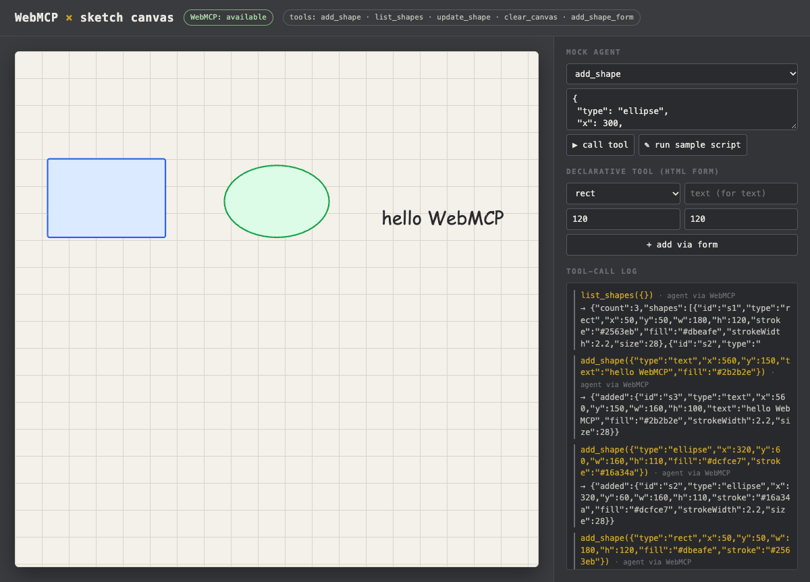

# WebMCP × sketch canvas

A tiny, single-file-ish (no build step) vector sketch canvas that exposes its actions to in-browser AI agents through **WebMCP**.


## Tools exposed

| Tool | Kind | What it does |
|---|---|---|
| `add_shape` | imperative (`document.modelContext.registerTool`) | add rect / ellipse / line / text |
| `list_shapes` | imperative (read-only) | list shapes with ids |
| `update_shape` | imperative | patch a shape by id |
| `clear_canvas` | imperative | remove everything |
| `add_shape_form` | declarative (`<form toolname tooldescription>`) | add a shape via an annotated HTML form |

If `document.modelContext` is missing, a banner appears and a built-in **mock agent** panel calls the *same* handlers, so the demo works in any browser.

## Run

```bash
python3 -m http.server 8000   # ES modules need http://, not file://
open http://localhost:8000/?autoplay   # ?autoplay runs a sample tool-call script
```

### Try real WebMCP in Chrome
- Chrome **149+**: enable `chrome://flags/#enable-webmcp-testing` (local dev), restart.
- Optional: install the **Model Context Tool Inspector** extension to list/call the tools (it may also want `chrome://flags/#prompt-api-tool-use`).
- For a deployed origin, register for the **WebMCP origin trial** and paste the token into the commented `<meta http-equiv="origin-trial">` in `index.html`.
- The declarative form API is documented by Chrome but is still listed as "future exploration" in the W3C CG explainer — treat it as experimental.

## Use it from Codex / Claude Code (native bridge)

Codex and Claude Code are MCP clients, and they **don't speak WebMCP natively**. WebMCP tools only exist inside a browser tab. [`bridge/`](bridge/) is a small stdio MCP server that translates between the two. It launches its own Chrome with `--enable-features=WebMCPTesting` and a throwaway profile (or attaches to one via `--cdp http://127.0.0.1:9222`), opens the page, reads `document.modelContext.getTools()`, and exposes each WebMCP tool as a **native MCP tool** with the same name, description and inputSchema. Calls are forwarded to `executeTool` in the page. When the page's tools change or it reloads, the bridge sends `tools/list_changed`. It also adds one helper tool, `webmcp_bridge_screenshot`.



**1. Start the demo and install the bridge** (Chrome 149+, Node 18+)

```bash
git clone https://github.com/Kayshen-X/webmcp-sketch.git && cd webmcp-sketch
python3 -m http.server 8000 &
(cd bridge && npm install)
```

**2. Register it** (these exact commands were run on macOS with Chrome 156)

```bash
# Codex (codex-cli 0.144.1) -> writes [mcp_servers.webmcp-sketch] to ~/.codex/config.toml
codex mcp add webmcp-sketch -- "$(which node)" "$PWD/bridge/index.js" --url http://localhost:8000

# Claude Code (2.1.278) -> writes to ~/.claude.json (user scope)
claude mcp add webmcp-sketch -s user -- "$(which node)" "$PWD/bridge/index.js" --url http://localhost:8000
claude mcp list   # webmcp-sketch: ... ✔ Connected
```

Bridge options: `--url <page>` (default `http://localhost:8000`), `--cdp <http://host:port>` to attach to an existing Chrome, `--chrome <path>`, `--headless`, `--screenshot-dir <dir>`.

**3. Ask the agent**

```bash
codex exec --skip-git-repo-check "Using the webmcp-sketch MCP tools: draw a rect, an ellipse and the text 'hello WebMCP' with add_shape, then call list_shapes."
claude -p "Using the webmcp-sketch MCP tools: draw a rect, an ellipse and the text 'hello WebMCP' with add_shape, then call list_shapes." --allowedTools "mcp__webmcp-sketch"
```

Verified end to end with `codex exec`, as in the screenshot above. For Claude Code, registration and `claude mcp list` → `✔ Connected` were verified. The `claude -p` run wasn't, because the test machine's Claude login had expired.

The agent calls `add_shape` and `list_shapes` directly, with no `browser_evaluate` glue. The page's log shows `agent via WebMCP`, and the pill reads `WebMCP: available`.

Notes:
- `executeTool(toolObject, argsObject)` in Chrome 156's `WebMCPTesting` takes the tool object returned by `getTools()` (the bridge looks it up by name). The API is experimental and may change.
- Alternative without the bridge: give the agent a generic browser via [Playwright MCP](https://github.com/microsoft/playwright-mcp) launched as Chrome with `--enable-features=WebMCPTesting`, then have it call `document.modelContext` through `browser_evaluate`. That works, but the tools aren't first-class MCP tools.
- `?autoplay` replays a sample script through the same `getTools`/`executeTool` path. `?mock` forces the mock agent.

## MCP vs WebMCP

| | MCP | WebMCP |
|---|---|---|
| Analogy | Call center (backend, always on) | In-store expert (on the page) |
| Runs | Server / process | Browser tab, page JS |
| Lifetime | Persistent | Ephemeral — only while the page is open |
| Primitives | tools, resources, prompts | tools only |
| Auth | Its own | Reuses the user's session |
| Best for | Core business logic | Contextual page actions |

Use both: MCP for core logic, WebMCP for what the user is looking at right now.

## Sources
- Explainer: https://github.com/webmachinelearning/webmcp
- Declarative explainer: https://github.com/webmachinelearning/webmcp/blob/main/declarative-api-explainer.md
- Chrome docs: https://developer.chrome.com/docs/ai/webmcp · https://developer.chrome.com/docs/ai/webmcp/declarative-api
- Inspired by Google Developers China (谷歌开发者) WeChat article, 2026-11-03: 「WebMCP 开发指南｜一文搞懂 WebMCP 与 MCP 的差异与协同」 https://mp.weixin.qq.com/s/4Ud_v6lkIBPom19uv5Qw_Q

## 中文简介
一个无需构建的小型矢量画板 demo：通过 WebMCP（`document.modelContext.registerTool` + 声明式 `<form toolname>`）把 `add_shape / list_shapes / update_shape / clear_canvas` 暴露给浏览器内的 AI agent。浏览器不支持时自动切换到内置「模拟 agent」，调用同一套处理函数。
体验：Chrome 149+ 打开 `chrome://flags/#enable-webmcp-testing`，或使用 WebMCP Origin Trial。
在 Codex / Claude Code 里用：它们本身不支持 WebMCP，`bridge/` 是一个 stdio MCP 服务器做翻译——启动带 `WebMCPTesting` 的独立 Chrome，读取页面 `document.modelContext.getTools()`，把每个 WebMCP 工具暴露成原生 MCP 工具，调用时转发到页面的 `executeTool()`，工具变化时发送 `tools/list_changed`。注册命令见上方 “Use it from Codex / Claude Code”（`codex mcp add` / `claude mcp add`）。
一句话：MCP 是呼叫中心，WebMCP 是店内专家——两者配合使用。灵感来自谷歌开发者公众号文章。

## License
MIT © 2026 kayshen
